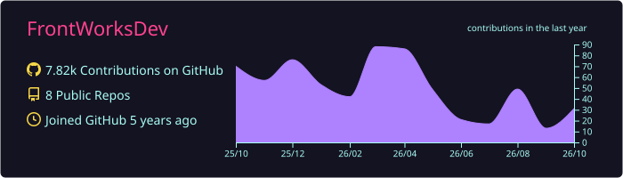
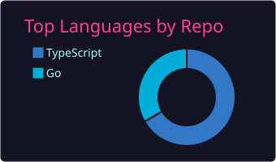
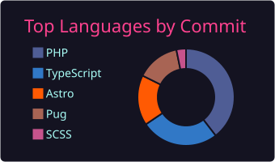
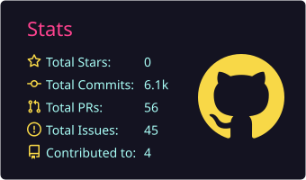

<h1 align="center">Hi 👋, I'm FrontWorksDev</h1>
<p align="center">Front-end Engineer</p>

<p align="center">
  <a href="https://frontworks.dev">🌐 Portfolio</a> ・
  <a href="https://twitter.com/FrontWorksDev">🐦 Twitter</a>
</p>

---

## Summary
<p align="center">
  
  
  
  
  
</p>

## ⏱ Weekly Coding Stats
<!--START_SECTION:waka-->


**I'm an Early 🐤** 

```text
🌞 Morning                44 commits          ██░░░░░░░░░░░░░░░░░░░░░░░   09.46 % 
🌆 Daytime                241 commits         █████████████░░░░░░░░░░░░   51.83 % 
🌃 Evening                158 commits         ████████░░░░░░░░░░░░░░░░░   33.98 % 
🌙 Night                  22 commits          █░░░░░░░░░░░░░░░░░░░░░░░░   04.73 % 
```
📅 **I'm Most Productive on Sunday** 

```text
Monday                   49 commits          ███░░░░░░░░░░░░░░░░░░░░░░   10.54 % 
Tuesday                  30 commits          ██░░░░░░░░░░░░░░░░░░░░░░░   06.45 % 
Wednesday                20 commits          █░░░░░░░░░░░░░░░░░░░░░░░░   04.30 % 
Thursday                 11 commits          █░░░░░░░░░░░░░░░░░░░░░░░░   02.37 % 
Friday                   44 commits          ██░░░░░░░░░░░░░░░░░░░░░░░   09.46 % 
Saturday                 73 commits          ████░░░░░░░░░░░░░░░░░░░░░   15.70 % 
Sunday                   238 commits         █████████████░░░░░░░░░░░░   51.18 % 
```


📊 **This Week I Spent My Time On** 

```text
🕑︎ Time Zone: Asia/Tokyo

💬 Programming Languages: 
TypeScript               3 hrs 12 mins       █████████░░░░░░░░░░░░░░░░   35.15 % 
PHP                      1 hr 13 mins        ███░░░░░░░░░░░░░░░░░░░░░░   13.36 % 
JavaScript               1 hr 12 mins        ███░░░░░░░░░░░░░░░░░░░░░░   13.16 % 
Other                    1 hr 5 mins         ███░░░░░░░░░░░░░░░░░░░░░░   11.98 % 
Astro                    45 mins             ██░░░░░░░░░░░░░░░░░░░░░░░   08.27 % 

🔥 Editors: 
Claude Code              7 hrs 4 mins        ███████████████████░░░░░░   77.39 % 
Neovim                   2 hrs               █████░░░░░░░░░░░░░░░░░░░░   21.89 % 
Chrome                   3 mins              ░░░░░░░░░░░░░░░░░░░░░░░░░   00.72 % 

💻 Operating System: 
Mac                      9 hrs 8 mins        █████████████████████████   100.00 % 
```

🤖 **AI Coding This Week** 

```text
⏱ AI Coding Time: 7 hrs 22 mins (80.79%)

✍️ 642 lines written by AI, 253 lines written by hand (71.73% AI-written)

🔤 1,746,356 Input Tokens, 724,046 Output Tokens

💵 $72.84 Estimated AI Cost This Week

🧠 13 AI Sessions, 229 AI Prompts

Sonnet                   783 lines           █████████████████████████   100.00 % 
Opus                     0 lines             ░░░░░░░░░░░░░░░░░░░░░░░░░   00.00 % 

🔎 AI Coding Insights:
🤖 AI-Driven — 71.73% of written lines came from AI
📝 Concise Prompter — average 419 characters per prompt
🔁 Iterative Prompter — average 18 prompts per session
🚀 High AI Trust — 33.86% of changed lines were hand-edited
```

**I Mostly Code in TypeScript** 

```text
TypeScript               5 repos             ████████████████░░░░░░░░░   62.50 % 
Go                       2 repos             ██████░░░░░░░░░░░░░░░░░░░   25.00 % 
JavaScript               1 repo              ███░░░░░░░░░░░░░░░░░░░░░░   12.50 % 
```


**Timeline**


 Last Updated on 14/10/2026 03:01:16 UTC
<!--END_SECTION:waka-->
