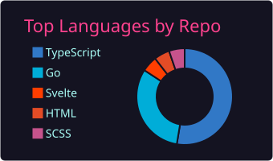
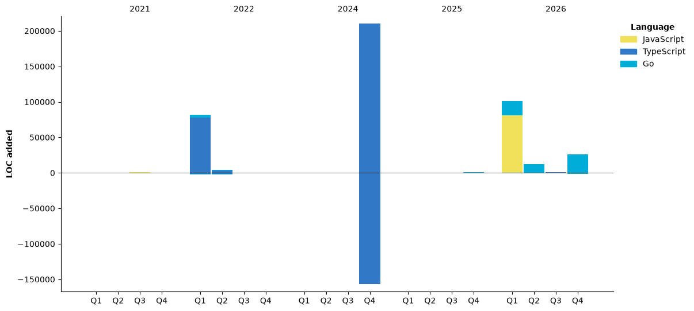

<h1 align="center">Hi 👋, I'm FrontWorksDev</h1>
<p align="center">Front-end Engineer</p>

<p align="center">
  <a href="https://frontworks.dev">🌐 Portfolio</a> ・
  <a href="https://twitter.com/FrontWorksDev">🐦 Twitter</a>
</p>

---

## Summary
<p align="center">
  
  
  
  
  
</p>

## ⏱ Weekly Coding Stats
<!--START_SECTION:waka-->


**I'm an Early 🐤** 

```text
🌞 Morning                46 commits          ██░░░░░░░░░░░░░░░░░░░░░░░   09.98 % 
🌆 Daytime                251 commits         ██████████████░░░░░░░░░░░   54.45 % 
🌃 Evening                142 commits         ████████░░░░░░░░░░░░░░░░░   30.80 % 
🌙 Night                  22 commits          █░░░░░░░░░░░░░░░░░░░░░░░░   04.77 % 
```
📅 **I'm Most Productive on Sunday** 

```text
Monday                   51 commits          ███░░░░░░░░░░░░░░░░░░░░░░   11.06 % 
Tuesday                  35 commits          ██░░░░░░░░░░░░░░░░░░░░░░░   07.59 % 
Wednesday                24 commits          █░░░░░░░░░░░░░░░░░░░░░░░░   05.21 % 
Thursday                 15 commits          █░░░░░░░░░░░░░░░░░░░░░░░░   03.25 % 
Friday                   35 commits          ██░░░░░░░░░░░░░░░░░░░░░░░   07.59 % 
Saturday                 74 commits          ████░░░░░░░░░░░░░░░░░░░░░   16.05 % 
Sunday                   227 commits         ████████████░░░░░░░░░░░░░   49.24 % 
```


📊 **This Week I Spent My Time On** 

```text
🕑︎ Time Zone: Asia/Tokyo

💬 Programming Languages: 
Markdown                 6 hrs 28 mins       █████████████░░░░░░░░░░░░   51.05 % 
Go                       3 hrs 30 mins       ███████░░░░░░░░░░░░░░░░░░   27.66 % 
Docker                   41 mins             █░░░░░░░░░░░░░░░░░░░░░░░░   05.49 % 
Diff                     32 mins             █░░░░░░░░░░░░░░░░░░░░░░░░   04.30 % 
Text                     26 mins             █░░░░░░░░░░░░░░░░░░░░░░░░   03.43 % 

🔥 Editors: 
Claude Code              12 hrs 31 mins      █████████████████████████   98.67 % 
Neovim                   7 mins              ░░░░░░░░░░░░░░░░░░░░░░░░░   01.01 % 
Chrome                   2 mins              ░░░░░░░░░░░░░░░░░░░░░░░░░   00.32 % 

💻 Operating System: 
Mac                      12 hrs 41 mins      █████████████████████████   100.00 % 
```

🤖 **AI Coding This Week** 

```text
⏱ AI Coding Time: 12 hrs 35 mins (99.15%)

✍️ 16,006 lines written by AI, 2 lines written by hand (99.99% AI-written)

🔤 9,222,841 Input Tokens, 1,591,961 Output Tokens

💵 $125.19 Estimated AI Cost This Week

🧠 18 AI Sessions, 355 AI Prompts

Opus                     12,107 lines        ██████████████████░░░░░░░   71.83 % 
Sonnet                   4,748 lines         ███████░░░░░░░░░░░░░░░░░░   28.17 % 
Haiku                    0 lines             ░░░░░░░░░░░░░░░░░░░░░░░░░   00.00 % 

🔎 AI Coding Insights:
🤖 AI-Driven — 99.99% of written lines came from AI
📚 Verbose Prompter — average 1,924 characters per prompt
🔁 Iterative Prompter — average 20 prompts per session
🚀 High AI Trust — 0.03% of changed lines were hand-edited
```

**I Mostly Code in TypeScript** 

```text
TypeScript               4 repos             ████████████░░░░░░░░░░░░░   50.00 % 
Go                       3 repos             █████████░░░░░░░░░░░░░░░░   37.50 % 
JavaScript               1 repo              ███░░░░░░░░░░░░░░░░░░░░░░   12.50 % 
```


**Timeline**




 Last Updated on 27/11/2026 15:15:45 UTC
<!--END_SECTION:waka-->
