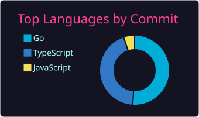
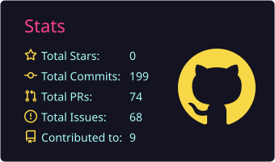

<h1 align="center">Hi 👋, I'm FrontWorksDev</h1>
<p align="center">Front-end Engineer</p>

<p align="center">
  <a href="https://frontworks.dev">🌐 Portfolio</a> ・
  <a href="https://twitter.com/FrontWorksDev">🐦 Twitter</a>
</p>

---

## Summary
<p align="center">
  
  
  
  
  
</p>

## ⏱ Weekly Coding Stats
<!--START_SECTION:waka-->


**I'm an Early 🐤** 

```text
🌞 Morning                44 commits          ██░░░░░░░░░░░░░░░░░░░░░░░   09.78 % 
🌆 Daytime                244 commits         ██████████████░░░░░░░░░░░   54.22 % 
🌃 Evening                142 commits         ████████░░░░░░░░░░░░░░░░░   31.56 % 
🌙 Night                  20 commits          █░░░░░░░░░░░░░░░░░░░░░░░░   04.44 % 
```
📅 **I'm Most Productive on Sunday** 

```text
Monday                   46 commits          ███░░░░░░░░░░░░░░░░░░░░░░   10.22 % 
Tuesday                  34 commits          ██░░░░░░░░░░░░░░░░░░░░░░░   07.56 % 
Wednesday                23 commits          █░░░░░░░░░░░░░░░░░░░░░░░░   05.11 % 
Thursday                 12 commits          █░░░░░░░░░░░░░░░░░░░░░░░░   02.67 % 
Friday                   34 commits          ██░░░░░░░░░░░░░░░░░░░░░░░   07.56 % 
Saturday                 77 commits          ████░░░░░░░░░░░░░░░░░░░░░   17.11 % 
Sunday                   224 commits         ████████████░░░░░░░░░░░░░   49.78 % 
```


📊 **This Week I Spent My Time On** 

```text
🕑︎ Time Zone: Asia/Tokyo

💬 Programming Languages: 
Other                    1 hr 31 mins        █████████░░░░░░░░░░░░░░░░   35.75 % 
Go                       1 hr 21 mins        ████████░░░░░░░░░░░░░░░░░   31.59 % 
Markdown                 55 mins             █████░░░░░░░░░░░░░░░░░░░░   21.62 % 
Lua                      15 mins             █░░░░░░░░░░░░░░░░░░░░░░░░   05.93 % 
Bash                     4 mins              ░░░░░░░░░░░░░░░░░░░░░░░░░   01.66 % 

🔥 Editors: 
Claude Code              4 hrs 7 mins        ████████████████████████░   96.60 % 
Neovim                   8 mins              █░░░░░░░░░░░░░░░░░░░░░░░░   03.40 % 

💻 Operating System: 
Mac                      4 hrs 16 mins       █████████████████████████   100.00 % 
```

🤖 **AI Coding This Week** 

```text
⏱ AI Coding Time: 4 hrs 8 mins (96.79%)

✍️ 5,033 lines written by AI, 0 lines written by hand (100.0% AI-written)

🔤 1,898,189 Input Tokens, 449,943 Output Tokens

💵 $37.77 Estimated AI Cost This Week

🧠 5 AI Sessions, 107 AI Prompts

Opus                     5,063 lines         █████████████████████████   100.00 % 
Sonnet                   0 lines             ░░░░░░░░░░░░░░░░░░░░░░░░░   00.00 % 
Haiku                    0 lines             ░░░░░░░░░░░░░░░░░░░░░░░░░   00.00 % 

🔎 AI Coding Insights:
🤖 AI-Driven — 100.0% of written lines came from AI
📄 Detailed Prompter — average 510 characters per prompt
🔁 Iterative Prompter — average 21 prompts per session
🚀 High AI Trust — 0.0% of changed lines were hand-edited
```

**I Mostly Code in TypeScript** 

```text
TypeScript               4 repos             ████████████░░░░░░░░░░░░░   50.00 % 
Go                       3 repos             █████████░░░░░░░░░░░░░░░░   37.50 % 
JavaScript               1 repo              ███░░░░░░░░░░░░░░░░░░░░░░   12.50 % 
```


**Timeline**


 Last Updated on 22/11/2026 05:25:10 UTC
<!--END_SECTION:waka-->
