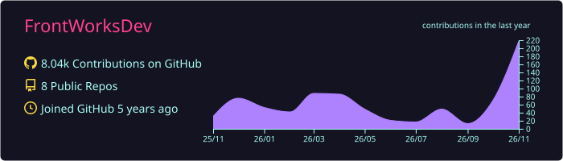

<h1 align="center">Hi 👋, I'm FrontWorksDev</h1>
<p align="center">Front-end Engineer</p>

<p align="center">
  <a href="https://frontworks.dev">🌐 Portfolio</a> ・
  <a href="https://twitter.com/FrontWorksDev">🐦 Twitter</a>
</p>

---

## Summary
<p align="center">
  
  
  
  
  
</p>

## ⏱ Weekly Coding Stats
<!--START_SECTION:waka-->


**I'm an Early 🐤** 

```text
🌞 Morning                47 commits          ███░░░░░░░░░░░░░░░░░░░░░░   10.17 % 
🌆 Daytime                251 commits         ██████████████░░░░░░░░░░░   54.33 % 
🌃 Evening                142 commits         ████████░░░░░░░░░░░░░░░░░   30.74 % 
🌙 Night                  22 commits          █░░░░░░░░░░░░░░░░░░░░░░░░   04.76 % 
```
📅 **I'm Most Productive on Sunday** 

```text
Monday                   51 commits          ███░░░░░░░░░░░░░░░░░░░░░░   11.04 % 
Tuesday                  35 commits          ██░░░░░░░░░░░░░░░░░░░░░░░   07.58 % 
Wednesday                24 commits          █░░░░░░░░░░░░░░░░░░░░░░░░   05.19 % 
Thursday                 15 commits          █░░░░░░░░░░░░░░░░░░░░░░░░   03.25 % 
Friday                   35 commits          ██░░░░░░░░░░░░░░░░░░░░░░░   07.58 % 
Saturday                 75 commits          ████░░░░░░░░░░░░░░░░░░░░░   16.23 % 
Sunday                   227 commits         ████████████░░░░░░░░░░░░░   49.13 % 
```


📊 **This Week I Spent My Time On** 

```text
🕑︎ Time Zone: Asia/Tokyo

💬 Programming Languages: 
Markdown                 7 hrs 9 mins        ████████████░░░░░░░░░░░░░   48.38 % 
Go                       4 hrs 14 mins       ███████░░░░░░░░░░░░░░░░░░   28.66 % 
Text                     47 mins             █░░░░░░░░░░░░░░░░░░░░░░░░   05.32 % 
Docker                   41 mins             █░░░░░░░░░░░░░░░░░░░░░░░░   04.70 % 
Other                    39 mins             █░░░░░░░░░░░░░░░░░░░░░░░░   04.49 % 

🔥 Editors: 
Claude Code              14 hrs 38 mins      █████████████████████████   98.86 % 
Neovim                   7 mins              ░░░░░░░░░░░░░░░░░░░░░░░░░   00.86 % 
Chrome                   2 mins              ░░░░░░░░░░░░░░░░░░░░░░░░░   00.28 % 

💻 Operating System: 
Mac                      14 hrs 48 mins      █████████████████████████   100.00 % 
```

🤖 **AI Coding This Week** 

```text
⏱ AI Coding Time: 14 hrs 42 mins (99.27%)

✍️ 20,745 lines written by AI, 2 lines written by hand (99.99% AI-written)

🔤 10,571,367 Input Tokens, 1,922,870 Output Tokens

💵 $150.51 Estimated AI Cost This Week

🧠 20 AI Sessions, 403 AI Prompts

Opus                     16,883 lines        ████████████████████░░░░░   78.05 % 
Sonnet                   4,748 lines         █████░░░░░░░░░░░░░░░░░░░░   21.95 % 
Haiku                    0 lines             ░░░░░░░░░░░░░░░░░░░░░░░░░   00.00 % 

🔎 AI Coding Insights:
🤖 AI-Driven — 99.99% of written lines came from AI
📚 Verbose Prompter — average 1,978 characters per prompt
🔁 Iterative Prompter — average 20 prompts per session
🚀 High AI Trust — 0.02% of changed lines were hand-edited
```

**I Mostly Code in TypeScript** 

```text
TypeScript               4 repos             ████████████░░░░░░░░░░░░░   50.00 % 
Go                       3 repos             █████████░░░░░░░░░░░░░░░░   37.50 % 
JavaScript               1 repo              ███░░░░░░░░░░░░░░░░░░░░░░   12.50 % 
```


**Timeline**


 Last Updated on 28/11/2026 05:48:39 UTC
<!--END_SECTION:waka-->
